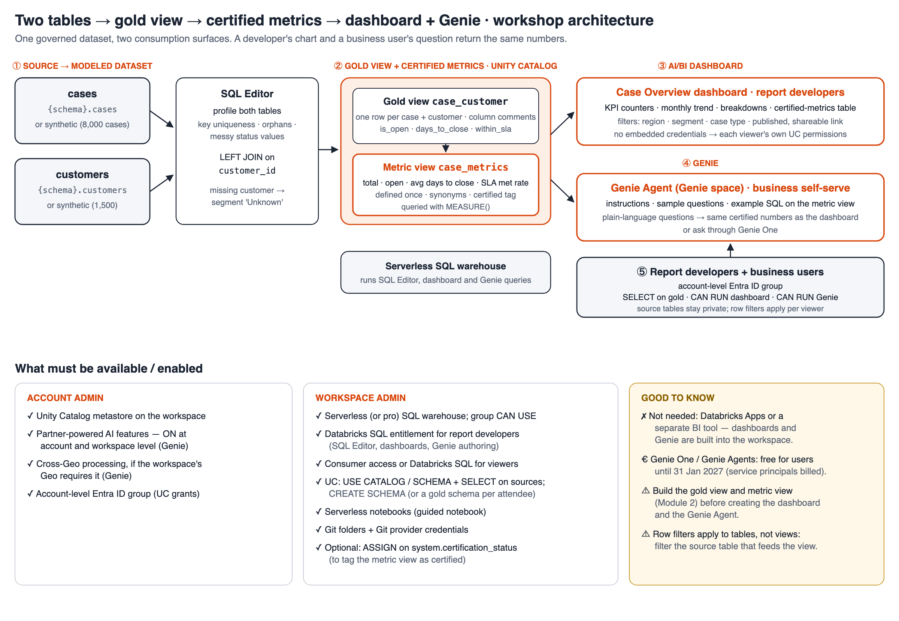

# Two Tables → Gold View → Certified Metrics → Dashboard + Genie — hands-on workshop

A 3.5-hour, hands-on workshop for **report developers**. You take two sourced tables, model them into one governed
dataset, and expose it on two surfaces that always agree: an **AI/BI dashboard** for report developers, and a
**Genie Agent** for business self-serve.

The steps:
- **① Source → modeled dataset:** profile both tables and join them on `customer_id`.
- **② Gold view + certified metrics:** a documented view, plus a Unity Catalog metric view.
- **③ AI/BI dashboard** with filters and a shareable link.
- **④ Genie Agent** with instructions and sample questions.
- **⑤ Governance, sharing and access control.**

## What's here

| Path | What it is |
|---|---|
| `sql/` | Scripts to paste into the SQL Editor: profiling and the join, the gold view, and the metric view |
| `src/00_setup.py` … `02_metric_view.py` | The same steps as notebooks, run by the guided notebook; `setup` can also create synthetic `cases` and `customers` tables |
| `dashboards/case_overview.lvdash.json` | The *Case Overview* AI/BI dashboard: KPI counters, trend, breakdowns, a certified-metrics table, and filters (answer key) |
| `genie/instructions.md` | Genie Agent setup: table descriptions, text instructions, example SQL and sample questions |
| `notebooks/Workshop_Steps.py` | **Executable guide**: profiles, builds the gold and metric views, creates and publishes the dashboard, creates the Genie Agent, and applies grants |
| `WORKSHOP_STEPS.md` | **Step-by-step execution guide**: admin prerequisites, UI steps per module, commands, troubleshooting |
| `docs/architecture.svg` / `.png` | The architecture, plus what must be enabled |

## Agenda (3.5 hours)

| Time | Module |
|---|---|
| 0:00–0:05 | Welcome and objectives |
| 0:05–0:15 | **Overview of Databricks**: Unity Catalog, metric views, Databricks SQL, AI/BI dashboards, Genie; where each module fits |
| 0:15–0:45 | **1 · Source to modeled dataset**: profile both tables, confirm the key, handle orphans and messy values, write the join |
| 0:45–1:20 | **2 · Gold view + certified metrics**: the documented view `case_customer` and the metric view `case_metrics`; lineage; the certified tag |
| 1:20–1:35 | Break |
| 1:35–2:25 | **3 · AI/BI dashboard**: datasets, KPI / trend / breakdown visuals, filters and a parameter; publish and share |
| 2:25–3:00 | **4 · Genie Agent**: instructions, sample questions, example SQL; business-style questions; Monitor |
| 3:00–3:10 | Break |
| 3:10–3:30 | **5 · Governance, sharing and access control**: gold-only grants, dashboard and Genie `CAN RUN`, embedded credentials, row-filter demo |

## What must be enabled

| Who | What |
|---|---|
| Account admin | Unity Catalog metastore · **partner-powered AI features** (Genie needs them) · cross-Geo processing if your Geo requires it · an **account-level** Entra ID group for attendees and viewers |
| Workspace admin | Serverless (or pro) SQL warehouse with `CAN USE` for the group · **Databricks SQL** entitlement for report developers; consumer access for viewers · UC `USE CATALOG` / `USE SCHEMA` / `SELECT` on the sources, plus `CREATE SCHEMA` · serverless notebooks · Git folders · optionally `ASSIGN` on `system.certification_status` |
| Not needed | Databricks Apps or a separate BI tool |

## Quick start

1. In the workspace, create a **Git folder** from this repo.
2. Open `notebooks/Workshop_Steps` and set the widgets: `catalog`, `schema` (the one holding `cases` and `customers`), `warehouse_id` and `group_name`. If you have no data yet, set *Synthetic data if missing* to `true`.
3. Click **Run all**. About 10 minutes later you have the gold view, the metric view, a published dashboard, a Genie Agent and the grants.

To build it by hand instead, follow `WORKSHOP_STEPS.md`, using the scripts in `sql/` and the setup in `genie/instructions.md`.

**Your own tables** need these columns:
- `cases(case_id, customer_id, case_type, channel, priority, status, opened_date, closed_date)`
- `customers(customer_id, customer_name, segment, region, customer_since, is_vip)`

If yours differ, map them in `sql/02_gold_view.sql` and `src/01_gold_view.py`.

All data in this repo is synthetic.
