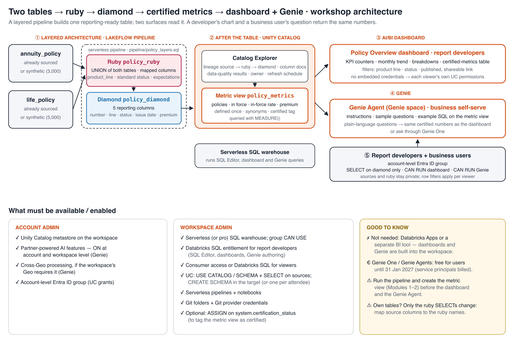

# Two Tables → Ruby → Diamond → Certified Metrics → Dashboard + Genie: step-by-step

**Audience:** report developers · **Duration:** 3.5 hours with 2 breaks · **Compute:** serverless pipeline + serverless SQL warehouse · **Architecture:** [`docs/architecture.png`](docs/architecture.png)

The flow:
- **① Layered architecture & pipeline:** union two tables into **ruby**, pare down to 5 columns in **diamond**.
- **② After the table:** data quality, lineage, documentation and a certified metric view.
- **③ AI/BI dashboard** for report developers.
- **④ Genie Agent** for business self-serve, on the same data.
- **⑤ Governance, sharing and access control.**

The build is deliberately small. The time goes on the layered architecture, the pipeline, and what you do with a table
once you have one you like.



## What's in this repo

| Path | What it is |
|---|---|
| `pipeline/policy_layers.sql` | Module 1: the Lakeflow pipeline, ruby `policy_ruby` (union) and diamond `policy_diamond` (5 columns) |
| `sql/01_explore_sources.sql` | Module 1: a quick look at the two sources in the SQL Editor |
| `sql/02_metric_view.sql` | Module 2: the certified metric view `policy_metrics` |
| `notebooks/00_Setup` … `05_Governance` | **One step-by-step notebook per module**, with a catch-up cell per step |
| `notebooks/06_Cleanup`, `notebooks/Run_All` | Delete your resources; run every module in order (facilitator dry run) |

---

## Step 0 · Before the day (admins, about one week ahead)

**Account admin**
1. Attach the workspace to a Unity Catalog metastore.
2. Turn on **partner-powered AI features** at account and workspace level. Genie needs this.
3. Turn on **cross-Geo processing** if the workspace's Geo requires it for Genie.
4. Sync an Entra ID group for attendees and viewers into the **account**, e.g. `workshop-users`, and assign it to the workspace. Unity Catalog grants only accept account-level groups.

**Workspace admin**
5. Make sure **serverless pipelines** and serverless notebooks are available.
6. Make sure there's a **serverless (or pro) SQL warehouse**, and give the group `CAN USE` on it.
7. **Entitlements:**
   - **Databricks SQL** for report developers (SQL Editor, dashboards, creating Genie Agents);
   - **consumer access** or Databricks SQL for viewers;
   - permission to **create pipelines** for report developers.
8. **Unity Catalog grants:**
   - `USE CATALOG`, `USE SCHEMA` and `SELECT` on the two source tables;
   - `USE CATALOG` and `CREATE SCHEMA` on the **target** catalog, or pre-create a schema per attendee. The target can be a different catalog from the sources.
9. **Optional:** grant `ASSIGN` on the `system.certification_status` governed tag, so attendees can mark the metric view as certified.
10. Make this repo available in your Git provider. Attendees clone it as a **Git folder** and need Git credentials set under **Settings → Linked accounts**.

> **Not needed:** Databricks Apps, or any separate BI tool. Pipelines, AI/BI dashboards and Genie are built into the workspace.

**Source data**
- Two related tables that are already sourced: `annuity_policy` and `life_policy`.
- They describe the same thing (a policy) with **different column names** and **different status values**. That's what the ruby layer resolves.
- **Using your own tables?** Only the two `SELECT`s in `policy_ruby` change: map each column to the ruby names and adjust the status mapping. Everything after ruby stays the same.
- **No data yet?** Set `create_sample_data = true`. The setup step creates about 3,000 annuity and 5,000 life policies, with inconsistent status spellings and a few rows with no policy number.

**Dry run (facilitator)**
1. Open `notebooks/Run_All` and set the widgets: the source catalog, schema and tables; the target catalog and schema; `warehouse_id` and `group_name`.
2. Click **Run all**. It takes about 10 minutes and ends with links to the pipeline, dashboard and Genie Agent.
3. Open the dashboard and the Genie Agent and check that they agree, for example on in-force policies by product line.
4. Run `notebooks/06_Cleanup` with *Confirm delete* = `yes`.

---

## 0:00 · Welcome & objectives (5 min)

Introductions and goals for the day. Check that everyone can log in, open **Jobs & Pipelines** and the **SQL Editor**, and see the Git folder.

## 0:05 · Overview of Databricks (10 min)

| Platform area | What it does | Today |
|---|---|---|
| **Lakeflow pipelines** | Declarative pipelines: you write the tables as SQL, the pipeline works out the order, runs it and checks data quality | Module 1 |
| **Unity Catalog** | One governance layer: grants, row filters, column masks, lineage, audit, certified assets | Modules 2 and 5 |
| **Metric views** | Business measures defined once in Unity Catalog and reused by dashboards, Genie and SQL | Module 2 |
| **Databricks SQL** | Serverless SQL warehouses and the SQL Editor | Modules 1–3 |
| **AI/BI dashboards** | Governed, shareable dashboards built into the workspace | Module 3 |
| **Genie** | Natural-language questions over governed data (Genie Agents and Genie One) | Module 4 |

End on the architecture diagram: **source → ruby → diamond**, then one diamond table feeding two surfaces.

## 0:15 · Module 1 — Layered architecture & the pipeline (30 min)

**Notebook:** `notebooks/01_Layered_Pipeline` walks through these steps, with a catch-up cell for each.

| Layer | Table | What it's for |
|---|---|---|
| Source | `annuity_policy`, `life_policy` | Already sourced. Left as they are |
| **Ruby** | `policy_ruby` | Both tables **unioned** into one conformed table: shared column names, a `product_line` column, standardised status. Rows without a policy number are dropped |
| **Diamond** | `policy_diamond` | Pared down to the **5 columns** reporting needs: `policy_number`, `product_line`, `policy_status`, `issue_date`, `premium_amount` |

1. **Look at the sources (5 min).** In the **SQL Editor**, run `sql/01_explore_sources.sql`. The tables use different column names (`policy_number` / `policy_no`, `contract_status` / `policy_status`) and status spellings. That's why the union needs a mapping.
2. **Create the pipeline.** Go to **Jobs & Pipelines → Create → ETL pipeline**:
   - name it `Policy layers (<you>)`;
   - set the **default catalog and schema** to your target, e.g. `policy_layers_<you>`;
   - choose **serverless**.
3. In the **Lakeflow Pipelines Editor**, replace the sample code with `pipeline/policy_layers.sql` (or add the file from your Git folder).
4. Under **Settings → Configuration**, add `source_catalog`, `source_schema`, `annuity_table = annuity_policy` and `life_table = life_policy`.
5. Click **Run pipeline**, then walk through:
   - **the pipeline graph:** source → `policy_ruby` → `policy_diamond`. The order comes from the SQL; you didn't write it;
   - **row counts per table**, and the **expectations**: `has_policy_number` dropped the rows with no policy number;
   - **the declarative idea:** each table is defined once, as a query. Change the diamond columns, run again, and only what's needed is recomputed.
6. **Schedule it:** **Schedule → Add schedule** (e.g. daily). Everything downstream (metric view, dashboard, Genie) reads the latest diamond data with no changes.

## 0:45 · Module 2 — What happens after you've built a table you like (35 min)

**Notebook:** `notebooks/02_After_the_Table` walks through these steps, with a catch-up cell for each.

1. **Catalog Explorer → `policy_diamond`:**
   - **Overview:** the table and column comments come from the pipeline SQL. Use **AI-generated** descriptions where they're missing;
   - **Lineage:** `annuity_policy` and `life_policy` → `policy_ruby` → `policy_diamond`, down to column level;
   - **Sample data** and **Details** (owner, which pipeline maintains it, last refresh).
2. **Data quality:** in the pipeline, open each table's **Data quality** tab. Rows passed and failed per expectation.
3. **Certified metrics:** run `sql/02_metric_view.sql`, replacing `<target_catalog>` and `<target_schema>`. It creates the metric view `policy_metrics` on the diamond table, which defines these measures once:

   | Measure | Definition |
   |---|---|
   | `total_policies` | `COUNT(1)` |
   | `in_force_policies` | status *In force* |
   | `in_force_rate` | in-force policies ÷ all policies |
   | `total_premium` | `SUM(premium_amount)` |
   | `avg_premium` | `AVG(premium_amount)` |

   It also defines the dimensions `product_line`, `policy_status`, `issue_year` and `issue_month`, with display names and synonyms that Genie uses.
4. Query it, wrapping every measure in `MEASURE()`:
   ```sql
   SELECT product_line, MEASURE(total_policies), MEASURE(in_force_rate), MEASURE(total_premium)
   FROM <target_catalog>.<target_schema>.policy_metrics GROUP BY ALL;
   ```
5. **Certify it:** run the last line of the script, which tags the view `system.certification_status = certified`. This needs `ASSIGN` on the tag. Show the certified badge in Catalog Explorer.

> **Why a metric view?** If "in-force rate" is computed in each chart or in each Genie answer, the numbers drift. Defining it once in Unity Catalog means the dashboard, Genie and ad-hoc SQL all agree.

## 1:20 · Break (15 min)

## 1:35 · Module 3 — Build the AI/BI dashboard (50 min)

**Notebook:** `notebooks/03_AIBI_Dashboard` walks through these steps, with a catch-up cell for each.

1. Go to **Dashboards → Create dashboard** and open the **Data** tab. Add two datasets:
   - **Policies (diamond):** an SQL dataset that selects the 5 diamond columns, plus `issue_month` and an `is_in_force` flag, from `policy_diamond`. This dataset powers the interactive visuals and filters.
   - **Certified metrics:** choose **Add data → `policy_metrics`** to use the metric view directly. Or use SQL with `MEASURE()` grouped by `product_line, policy_status`.
2. On the **Canvas**, build the visuals. `dashboards/policy_overview.lvdash.json` is the answer key: import it with **Dashboards → Create → Import dashboard from file**, then set each dataset's catalog and schema to your target schema in the **Data** tab.

   | Visual | Field or measure |
   |---|---|
   | Counter: Total policies | `COUNT(policy_number)` |
   | Counter: In-force policies | `SUM(is_in_force)` |
   | Counter: In-force rate | `AVG(is_in_force)`, formatted as a percentage |
   | Counter: Total premium | `SUM(premium_amount)`, formatted as currency |
   | Line: policies issued per month | `issue_month` × `COUNT(policy_number)`, coloured by `product_line` |
   | Bar: policies | by `policy_status` |
   | Bar: total premium | by `product_line` |
   | Bar: average premium | by `product_line` |
   | Table: certified metrics | the metric view, by `product_line` and `policy_status` |

3. Add **filters**: multi-select on `product_line` and `policy_status`, connected to both datasets.
4. **Parameter exercise:** clone the *Policies* dataset, add `WHERE issue_date >= :from_date` (default one year ago), connect a date filter to the parameter, and point the trend chart at the clone.
5. **Publish:**
   - Turn **embed credentials** off, so viewers query with their own permissions.
   - **Share** with the group as **Can run**.
   - Copy the link.
6. **Check:** with no filters, the counters must match the certified table's totals. *Same numbers, one definition.*

## 2:25 · Module 4 — Create the Genie Agent (35 min)

**Notebook:** `notebooks/04_Genie_Agent` walks through these steps, with a catch-up cell for each.

1. Go to **Genie → New**, add `policy_diamond` and `policy_metrics`, and choose the serverless warehouse.
2. Under **Instructions**, paste the text instructions from `genie/instructions.md`:
   - prefer the metric view, using `MEASURE()`;
   - define *in force* and *premium* (annuity single premium vs life annualised premium);
   - set formatting rules.
3. Add the two **example SQL** queries and the four **sample questions** from the same file.
4. Test business-style questions:
   - *How many policies are in force by product line?* Compare with the dashboard.
   - *What is the in-force rate by product line and issue year?*
   - *What is the total premium for annuities issued in the last 12 months?*, then follow up with *…and for life?*
5. In **Monitor**, look at the questions asked and the SQL that was generated. Turn a good answer into a new example query.

## 3:00 · Break (10 min)

## 3:10 · Module 5 — Governance, sharing & access control (20 min)

**Notebook:** `notebooks/05_Governance` walks through these steps, with a catch-up cell for each.

| Layer | Grant | Where |
|---|---|---|
| Data | `USE CATALOG` and `USE SCHEMA`, plus `SELECT` on **`policy_diamond` and `policy_metrics` only** | Catalog Explorer → Permissions, or `GRANT …` |
| Pipeline | **Can view** (optional, to see runs and data quality) | Pipeline → Permissions |
| Dashboard | **Can run** (published) | Dashboard → Share |
| Genie Agent | **Can run** | Genie → Share |

```sql
GRANT USE CATALOG ON CATALOG <target_catalog> TO `workshop-users`;
GRANT USE SCHEMA ON SCHEMA <target_catalog>.<target_schema> TO `workshop-users`;
GRANT SELECT ON TABLE <target_catalog>.<target_schema>.policy_diamond TO `workshop-users`;
GRANT SELECT ON TABLE <target_catalog>.<target_schema>.policy_metrics TO `workshop-users`;
```

Discussion points:
- **Each layer has its own audience.** Viewers get diamond only. Ruby and the sources stay with the people who build the pipeline.
- **Embedded credentials:** off means each viewer's Unity Catalog permissions apply. On means everyone sees what the publisher can see.
- **Genie:** compute runs on the author's embedded warehouse credentials, but **data access is always the end user's**.
- **Demo: different rows per viewer.** Pipeline tables take a row filter in their definition. Create the function, then add it to `policy_diamond` in the pipeline SQL and run the pipeline again:
  ```sql
  CREATE FUNCTION <target_catalog>.<target_schema>.product_filter(pl STRING) RETURN
    NOT is_account_group_member('workshop-users') OR pl = 'Life';
  ```
  ```sql
  CREATE OR REFRESH MATERIALIZED VIEW policy_diamond (
    ...                                   -- columns and expectation as before
  )
  WITH ROW FILTER <target_catalog>.<target_schema>.product_filter ON (product_line)
  COMMENT '...' AS SELECT ...;
  ```
  Group members now see only Life policies in both the dashboard and Genie. Remove the `WITH ROW FILTER` line and run again to undo.

Wrap up: two sources, two layers, one governed table, two surfaces, one set of numbers.

**Clean up:** run `notebooks/06_Cleanup` with *Confirm delete* = `yes`.

---

## Troubleshooting

| Symptom | Fix |
|---|---|
| Pipeline fails with *TABLE_OR_VIEW_NOT_FOUND* on a source | Check the pipeline **Configuration** (`source_catalog`, `source_schema`, table names), and that you have `SELECT` on the sources. |
| Pipeline fails with *UNRESOLVED_COLUMN* in `policy_ruby` | Your source columns have different names. Map them in the two `SELECT`s in `policy_ruby`. |
| Many rows show `policy_status = 'Unknown'` | A status value isn't in the mapping. The `known_status` expectation counts them. Add the value to the `CASE`. |
| `MEASURE` errors such as *cannot resolve* | Every measure from a metric view must be wrapped in `MEASURE(<name>)`. Dimensions are not. |
| Dashboard viewers see *Permission denied* | Embed credentials is off, so grant the viewer `SELECT` on `policy_diamond` and `policy_metrics`, or turn embedding on. |
| The Genie sidebar icon shows but Genie won't open | Partner-powered AI features are off (account admin). |
| `GRANT … TO workshop-users` fails with *PRINCIPAL_DOES_NOT_EXIST* | The group is workspace-local. Use an account-level group. |
| `SET TAGS ('system.certification_status' …)` is denied | You need `ASSIGN` on that governed tag. Skip it, or ask an admin. |
